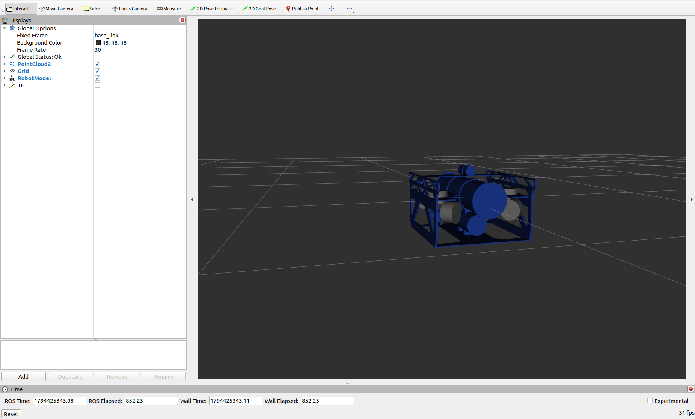
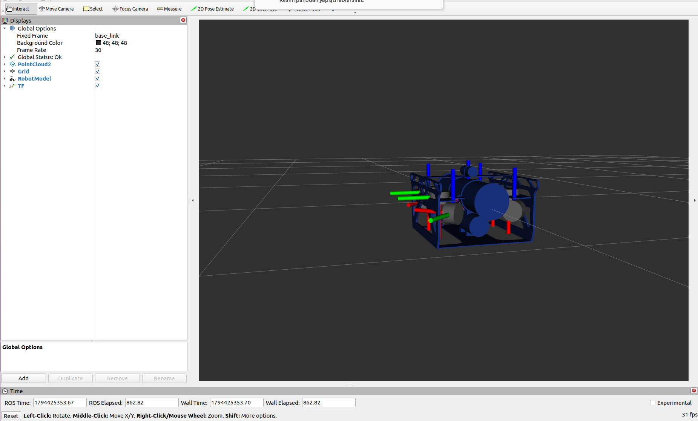
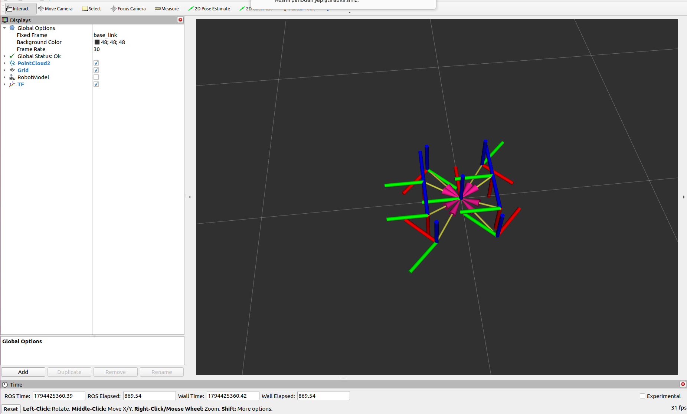
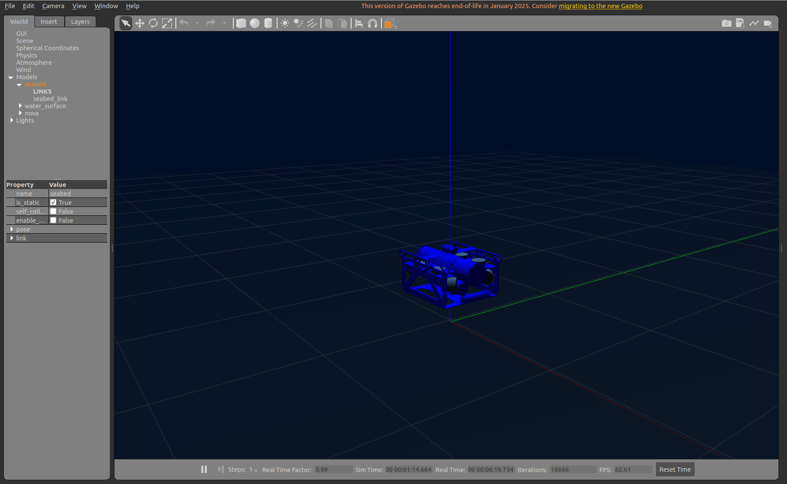

# NOVA AUV — Simulation Workspace

ROS2 Humble tabanlı 8 motorlu (6-DoF) sualtı insansız aracı (AUV) simülasyon workspace'i.

## Görseller

| RViz — Robot Modeli | RViz — TF Ağacı |
|:-------------------:|:---------------:|
|  |  |

| RViz — Sadece TF Çerçeveleri | Gazebo — Sualtı Simülasyonu |
|:----------------------------:|:---------------------------:|
|  |  |

## Gereksinimler

```bash
sudo apt install ros-humble-desktop ros-humble-gazebo-ros-pkgs \
  ros-humble-robot-state-publisher ros-humble-xacro \
  ros-humble-gazebo-ros2-control
```

## Kurulum

```bash
cd ~/novasim_ws
source /opt/ros/humble/setup.bash
colcon build --symlink-install
source install/setup.bash
```

## Simülasyonu Başlatma

```bash
ros2 launch nova_bringup simulation.launch.py
```

Teleop (ayrı terminalde):
```bash
source ~/novasim_ws/install/setup.bash
ros2 run nova_control teleop
```

## Kontroller

| Tuş | Hareket |
|-----|---------|
| W / S | İleri / Geri |
| A / D | Sol / Sağ yengeç |
| Q / E | Sola / Sağa dön (yaw) |
| Y / H | Yukarı / Aşağı |
| T / G | Hız artır / azalt |
| Space | Dur |

## Paketler

| Paket | Açıklama |
|-------|----------|
| `nova_description` | URDF, STL mesh, Gazebo world, RViz config |
| `nova_msgs` | Custom mesaj tipleri |
| `nova_control` | Thruster allocator, hydrodynamics, teleop |
| `nova_bringup` | Launch dosyaları |
| `nova_sensors` | Sensör ekleme için iskelet paket |
| `nova_autonomy` | Otonom navigasyon için iskelet paket |

## Araç Özellikleri

- **Boyutlar:** 625mm × 500mm × 350mm
- **Motorlar:** 8× BlueRobotics T200
  - T1-T4: Yatay, 45° açılı (surge/sway/yaw)
  - T5-T8: Dikey (heave/roll/pitch)
- **Fizik:** Quadratic underwater drag, su yüzeyi kısıtı (z ≤ 5m)
